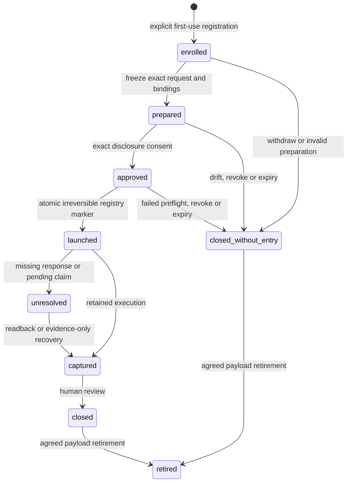

# One real-reminder contextual capture pilot

Historical proposal: SPINE-074 supersedes this architecture for the selected
[opt-in enriched delivery slice](notification-enrichment-delivery.md). The registry,
format-3 and seven-day purge below are not implementation prerequisites. Preserve
this draft as design history; it does not authorize execution.

Version: `0.1.0-draft.1`

Status: Proposed Spine design, SPINE-073 (drafted 2026-11-05, completed 2026-11-06). Not ratified, implemented
or permission to read a real ledger, enroll a reminder or disclose data. The
[operator plan](../docs/CONTEXTUAL_NOTIFICATION_REAL_CAPTURE_PILOT.md) records
implementation sequencing and the bounded Impetus owner handoff. Existing
[synthetic live capture](contextual-notification-live-capture.md), checkpoints
`1f7947d` and `726b14a`, retains its synthetic-only meaning. The
[single synthetic trial](../docs/CONTEXTUAL_NOTIFICATION_SINGLE_TRIAL_REVIEW.md)
proved one no-addition path; it did not qualify real-reminder disclosure.

## 1. Selected first boundary

Observe one future, already-materialized notification opportunity for one
non-sensitive, non-recurring event on an existing Spine ledger. Use one trusted
local operator acting as the event's resolved subject owner. Capture one provider
count and at most one context-only generation, with zero tools/retries. Review
addendum, no_addition, failure, uncertainty and lateness alike. No second selected
opportunity, recurrence sampling, daemon scheduling or automatic enrollment.

This pilot reads canonical state and writes only private experiment records.
Ordinary reminder rendering, eligibility, routing, scheduling and delivery continue
independently. Every experiment capture remains selected=false and sent=false.
An ordinary reminder may still be sent by its existing worker; those flags do
not describe that independent delivery. Research never delays, consumes, cancels
or creates notification work or a notification delivery attempt.

This is the direct experiment from [the broader draft](contextual-notification-experiment.md),
without governance admission. Local consent records are disclosure evidence, not
Threshold grants, authenticated identities or native acceptance. Spine owns source
and consent; Impetus owns provider entry, credentials, execution and accounting.
No new public web/MCP command, ledger migration or general approval service is proposed.

## 2. Eligibility and source access

Select an exact `(ledger_instance_id, work_instance_id, notification_opportunity_id)`;
do not scan an agenda to find convenient personal data. The operator separately
authorizes the eventual local read/selection. No actual IDs or database paths are
selected by this design. Refuse unresolved/legacy ownership, group-owned events,
unknown actor authority, cancelled/archived events, tasks, recurrence/occurrence
work, all-day events, stale policy/work and missing archetype/timezone facts.
The event must have one fixed event-start instant and an eligible ordinary
notification work instance, with no previous delivery attempt at original entry.
Require `event_start > nominal_reminder > now` and a positive whole-second offset;
post-event follow-ups are outside this first pilot.
Materialization remains the ordinary authoring path's responsibility.

Use a new existing-ledger read adapter, not `initialize`/`seed` and not a
`synthetic_only=false` switch on either current experiment service. Open an
existing database read-only with a short bounded read transaction, query-only
defense and ordinary schema/identity checks. Never create a missing file, migrate,
initialize, change journal mode, run deep verification or hold a transaction
through human review or provider I/O. The existing `ledger.connect` bootstrap
changes journal mode and is not the proposed real-source opener. An unavailable
source produces no invocation; it does not justify a writable fallback or a
detached database-file copy that might omit current WAL state.

Local host privilege does not establish ownership or permission to disclose.
Resolve current owner/actor facts separately from the trusted-local CLI exception
in [permissions](permissions.md). The operator must explicitly attest that the
selected values are non-sensitive and authorized for the named provider, including
any incidental third-party text. Medical/other sensitive context and unresolved
third-party disclosure are excluded. No automatic sensitivity classifier is claimed.

## 3. Minimized disclosure and exact consent

| Data | Proposed first-pilot rule |
| --- | --- |
| Event title, fixed start, display timezone, archetype key | Required; exact values reviewed, never inferred from other items |
| Nominal ordinary reminder body, eligibility instant and event offset | Required; exact bytes reviewed; body remains a nominal preview |
| Facets | Empty by default; optionally at most four explicitly approved primitive fields from one pinned facet revision |
| Primitive facet values | Only string, boolean or integer, within existing owner byte/type bounds; exact values and field/revision allowlist pinned |
| Notes, summary, unrelated items, participant/assignee/contact/recipient/route details | Excluded; permission to render or read them does not grant model disclosure |
| Structured location, reference-valued facets, containers, tool inputs | Excluded; do not traverse references or derive missing arguments |
| Work ID, source_refs and execution binding pins | Local Impetus identity only; the adapter sends objective/context to the provider, including any approved facet schema-revision IDs inside context |
| Model/provider/endpoint/credential/launcher/tariff choices | Trusted operator configuration only, never event or model content |

The ordinary renderer can include a primary-location label and facet-detail
suffixes. Empty `context.facets` alone does not exclude those values from prose.
Selected facets also need existing item/catalog read/use authority; recipient
rendering disclosure is not provider disclosure. An unreadable definition or
unresolved field authority refuses the pilot rather than exporting raw values.
For this first pilot, require **no primary location and ordinary/base rendering
without a facet-detail presentation**. Refuse a source that would render those
extras; do not change its policy or silently rewrite the baseline to qualify it.
All remaining prose still requires human review: a title or primitive facet can
itself contain excluded sensitive, location/contact or identifying third-party
text. Primitive type is not disclosure authority; refuse such a value rather
than smuggling excluded context into another field. No partial redaction, placeholder title, truncated
body or substituted nominal reminder is permitted in this slice.

Prepare the exact export locally while invocation is disabled. The private preview
shows the model-visible context/objective, source/binding references sent locally,
named provider/configuration/prompt, both count and generation disclosures,
execution/accounting limits and the retention/access policy. Do not automatically
copy the preview to chat, telemetry or repository files. Human consent is bound to
the full exact request digest, source/disclosure fingerprint and configuration
revision; item opt-in alone or approval of a field name is insufficient.
The operator can inspect a private local artifact; an agent-facing preparation
receipt should contain only approved metadata/digests, not the real payload.
Access by a chat assistant or another review destination needs its own explicit
disclosure scope. Do not require pasting personal reminder text into this chat.

Record approval in an append-only operator-owned record with the exact source key,
actor/owner, approved-at UTC, expiry no later than cutoff, request SHA-256,
source/disclosure/configuration hashes, wire/schema/prompt pins and retention-policy
revision. This is a trusted-host action, not a cryptographic signature or new
source-ledger grant. Changing any approved value requires new consent and cannot
rewrite the frozen request or reopen the opportunity. A failed/drifted frozen
preparation closes this pilot without automatic substitution.

Keep entry expiry separate from retained-review expiry: original entry consent
ends by cutoff, while explicitly approved frozen-snapshot review may last only
until the content-retention deadline. Withdrawing pilot consent disables new entry,
hypothetical use and payload display. It does not falsify retained execution or
promise immediate erasure before the agreed owner closeout.

Before launch, recheck current consent, ownership, content/disclosure/configuration
and ordinary eligibility. Revocation committed before the launch marker prevents
entry. Revocation after that marker cannot promise to stop count/generation already
authorized or remote billing; retain facts, invalidate hypothetical use and allow
no new invocation. A short source read and a private marker cannot form an atomic
transaction with source changes or provider entry. The approved disclosure is of
the exact frozen snapshot; later source changes add no new disclosed fields and
make its result stale. No claim of instantaneous cross-process revocation is made.

## 4. Identity and continuity on an existing ledger

Keep the actual source ledger namespace and ordinary opportunity ID. Retain the
existing derivation exactly:

`work_id = "experiment:" + sha256(sorted_compact_json({version:
"spine.experiment-work.v1", ledger: ledger_instance_id, opportunity:
notification_opportunity_id}))`

Do not include pilot, profile, provider, consent, time, configuration, prompt or
transport identifiers in that derivation. A new pilot name does not create new
research for the same opportunity. Resolve a known source key before any new
render/export. A changed item/policy/opportunity during this pilot closes the
original enrollment; even a genuinely new successor opportunity is not automatically
selected by its one-opportunity authorization.

**Proposed continuity choice:** use one small persistent local enrollment registry
at a deployment-designated location outside the checkout, separate from content
payload stores. Its identity/location is fixed in trusted configuration before
source selection. A unique `(ledger namespace, opportunity)` row binds the source
work ID, one enrollment, one content-store identity and one independent owner store.
The first pilot has capacity one enrollment and one original launch, not a new
quota for every profile or UTC day. This is private experiment metadata, not a
general component registry or canonical coordination authority.

The registry is the sole launch-marker authority. Commit the enrolled key before
export; persist exact request/binding together in the content sidecar; then pin
their digest in the registry before approval. After a partial preparation, resolve
the already-frozen bytes instead of recapturing. A missing/ambiguous pair or digest
conflict is unavailable continuity and cannot launch. Commit approval revision and
the irreversible original-entry marker atomically in the registry **before spawn**.
A crash before any optional content-side marker mirror still leaves launch consumed.
Never treat a content-side marker as authority to overrule the registry.

The proposed real content sidecar is a fresh **format 3**, with explicit enrollment
and registry references, original request/binding and append-only captures. Do
not open a format-1/2 store as real data, migrate synthetic opportunities or narrow
the complete owner schema. Proposed real capture identity:
`spine.contextual-notification-real-capture.v1`; this name is a design reservation,
not a published machine contract. Its closed schemas must precede implementation.

Bootstrap requires a separately approved first-use registration with known prior
experiment history for the selected namespace/opportunity. A fresh empty file or
owner `absent` read is not evidence that no earlier invocation exists. Refuse
unknown history. Open registered stores only; no create-if-missing, reset,
replacement worker namespace, reinitialization or automatic restore reconciliation.
Match source identity, private registry/content identities and the enrolled owner
locator/namespace on each open. The current owner metadata exposes a namespace,
not a store-instance UUID; the first proposal therefore also pins operator-owned
directory/file identity and requires a no-out-of-band-replacement assumption.
Filesystem identity cannot detect every in-place rollback. Known rollback, missing
expected records or uncertain continuity disables all new admissions; readback may
remain possible. No hostile-host or coordinated-rollback qualification is claimed.

The registry and its compact retired-key records must outlive payload retirement
and backups/restores. If the registry is lost, do not reconstruct a new launch
permission from an empty sidecar or reminder eligibility. Resolve retained history
manually or leave this feature disabled. Broader recovery/storage campaigns remain
deferred; none is required to implement the bounded offline oracles below.

## 5. Proposed lifecycle and readback

No arrow returns to approved/launched. One launch may contain no provider entry,
count only, or count plus generation. Rejection, process loss, count failure,
generation failure/mismatch, absent/unavailable read or lost stdout never clears
the marker or authorizes another invoke. The operator may read repeatedly; it
does not consume new research quota. Recovery requires known worker exit and
the owner's evidence-only operation; it never resumes provider work.

Readback uses stored namespace/work/digest, wire/schema/configuration/prompt
bindings, registry identity and owner-store binding. It needs no credentials,
live enablement, current provider configuration file or reachable source ledger.
Content-bearing local review additionally requires the original retained-review
consent still to be in force; that consent covers only the frozen snapshot until
its retention deadline, not new source data. Revoked/expired review access yields
local status/accounting metadata only, even if an owner execution can still be
read internally. The private capture may retain facts until agreed closeout;
do not falsify or expose its proposal to work around a display restriction.
Execution facts and current source/consent/eligibility assessments are separate.
Source unavailability or revocation makes hypothetical use unavailable/stale,
not the original execution absent or failed. Do not fabricate current freshness
from the old snapshot or rewrite earlier finite observations. After payload
retirement expose only local retired metadata; do not query a replacement owner
store or pretend content-bearing readback is still available.

## 6. Timing, ordinary delivery and freshness

Propose a 300-second preparation lead ending at nominal reminder eligibility.
The request's expiry and selection cutoff both equal that nominal instant.
Require more than 30 seconds remaining at original launch; do not move the reminder
or extend its late-handling rules to accommodate review. Impetus still clips its
shared 20-second budget, gives counting at most five seconds and requires at least
one second remaining before generation. Use actual UTC observations with SPINE-072
fractional precision and the existing conservative owner clock/deadline rules.

Maintain three separate observations:

| Assessment | Proposed meaning |
| --- | --- |
| Content/disclosure freshness | Current selected item/version, relevant ownership, policy meaning, archetype/facet/rendering pins, approved values and configuration match the frozen preparation |
| Ordinary eligibility | Current work/policy/route/state and absence of an already-started attempt allow the ordinary reminder at the assessment time |
| Execution usability | A valid succeeded execution, current consent/content, ordinary eligibility and `completion <= observation <= cutoff` |

Normal progression to in_progress/succeeded work, or an ordinary attempt, is not
a content edit. It does prevent later hypothetical selection. Source access must
not depend on the work staying eligible merely to retrieve old execution. No
experiment acknowledgement writes work status, attempts, audit, item versions,
notification bodies or schedules. An independent delivery may legitimately change
the canonical ledger while capture runs; compare relevant source facts and prove
the pilot emitted no writes rather than requiring whole-ledger equality during
normal operation. Offline tests with no concurrent writer can also compare dumps.

The exported body is explicitly `nominal_preview`. For human comparison, authorized
local readback may reference the existing actual ordinary attempt and its retained
body/hash. Never create an attempt just to obtain that baseline. If actual body is
unavailable or differs, label it unavailable/changed; do not silently equate the
preview with a sent message or disclose a newly enriched body to the provider.

## 7. Execution pins and wire compatibility

Candidate unchanged wire: interface `contextual-notification-experiment`, version
`impetus.openai.v1`, owner checkpoint
`5ff3c0c4530fe07e81cc9067eddadd967a90acc4`, complete schema SHA-256
`bf3d132392c41ab21e9f7bf44f765aa79799a8dd41f8666d1d39ad646c442c4b`.
The shape supports event context, primitive facets and real source identifiers
without a synthetic-only wire flag. Schema acceptance is not consent or owner
adoption of this operating scope. Do not add registry, consent or real-mode fields
to the closed request; they are local Spine bindings.

Reuse mandatory count ordinal 1, one generation ordinal 2, zero tools and all
current request byte/output/token/arithmetic/usage/reservation/model/prompt/timing
and actual-generation-reference checks. Retain valid late, failed and uncertain
facts without a usable proposal. Keep source/disclosure/configuration fingerprints,
the exact original request including newline, complete schema pin and prompt
revision `helpful-personable-openai.v1`. Configuration revision remains the owner's
insertion-order compact JSON digest, not a sorted-key or raw-file hash.
Wire limits remain model_calls=1, tool_calls=0, elapsed_seconds=20 and
addendum_utf8_bytes=512, with allowed_tools=[] and a 65,536-byte original request
ceiling. No counting call is hidden inside the generation count.

Operational receipts/errors use bounded metadata-only local reason codes, not
source values, provider transcripts or exception text. Distinguish disclosure or
consent refusal, unknown continuity, source unavailability, no original entry,
unresolved execution and retired content. These local classifications do not
extend the owner's closed disposition/reason enums.

The execution configuration is selected and qualified later, with explicit count
contingency and complete model/rate/token bounds. The pilot admits at most one
run within the existing owner ceilings; it creates no model/tariff default or
claim of an upstream billing cap. The synthetic trial's accounting is historical
evidence, not current real-data account or retention qualification. Credentials
and their locators remain worker-launcher-only, outside source, consent payload,
request/capture records and the checkout.

## 8. Local retention and owner agreement

Proposed policy for explicit consent: retain source-bearing experiment copies,
request/configuration bindings, proposal/review text and owner raw records privately
for **at most seven days after preparation**, including an abandoned preparation.
No automatic upload, diagnostics with real content or backup outside the approved
local operator boundary. Restrict directory/file permissions and local review to
the approving owner/operator. Source-ledger records have their own existing
lifecycle and are not deleted by this pilot. Provider-side terms must be separately
qualified; `store=false` does not establish provider-wide zero retention.

Before real enrollment, agree and test a bounded closeout procedure with Impetus:
confirm no local invocation remains active, retain final known/unknown accounting,
irreversibly retire the enrollment in the persistent registry, then retire/purge
only the dedicated Spine content store and owner payload store plus enumerated
private copies. Retired state never becomes a fresh store. This procedure is not
an existing supported command and is not authorized by this design. Do not mutate
the other owner's SQL tables or delete its database from the Spine runtime:
each owner supplies its own procedure, coordinated by the explicitly authorized
operator. Do not invent successful erasure of SQLite WAL, backup
or exported copies. Permission, copy inventory and removal evidence must be part
of that later operator-approved closeout. If safe retirement cannot be supported,
do not enroll real data under a seven-day retention promise.

Retain compact continuity/accounting metadata after content retirement: source
namespace/opportunity/work keys, request digest, consumed marker, approved binding
digests, run day/status, call counts, known usage plus residual reservations and
retirement receipt. These are linkable local metadata, not anonymized data. Do not
release unknown liability or reset owner daily exposure when deleting payloads.
Impetus must agree the accounting receipt/retirement treatment; Spine cannot
declare itself the authority for owner accounting. The accounting receipt stays
Impetus-owned or in its approved operator archive; the registry can retain a
receipt digest and observed amounts, not replace authoritative daily accounting.
No later fresh store may admit calls without preserving/enforcing retired exposure.
Consent explicitly covers this
longer-lived metadata. Removing continuity metadata as well requires leaving new
admissions for that namespace disabled; erasure is never permission to repeat work.

The owner documents require an agreed real-reminder retention/deletion policy,
while currently qualified operations retain complete synthetic records. Therefore
an **Impetus scope/retention confirmation is a real prerequisite**, even if no
wire revision or producer code change is ultimately necessary. Do not modify or
send a handoff to Impetus under this design-only task. This is task-specific
retention, not a restart of the deferred resilience/storage roadmap.

## 9. What must precede implementation and real use

Review this draft's eligibility/disclosure, registry/format-3 and retention choices.
Codify closed Spine enrollment/consent/registry/capture schemas, independent fake
vectors and format/resource version declarations before runtime implementation.
The [offline oracles and owner questions](../docs/CONTEXTUAL_NOTIFICATION_REAL_CAPTURE_PILOT.md)
are the implementation acceptance boundary. Preserve all existing format-1/2,
deterministic/reminder/rendering/delivery and schema-19/release behavior.

Only after the offline implementation and owner scope/retention agreement are
accepted should the operator separately select an exact real reminder, authorize
its local preview, approve its exact disclosure/configuration/retention and enable
one invocation. Designing or implementing this pilot grants none of those actions.
Generated delivery, more reminders, protected remote admission, new tools,
subscription adapters and general failure campaigns remain separate work.
